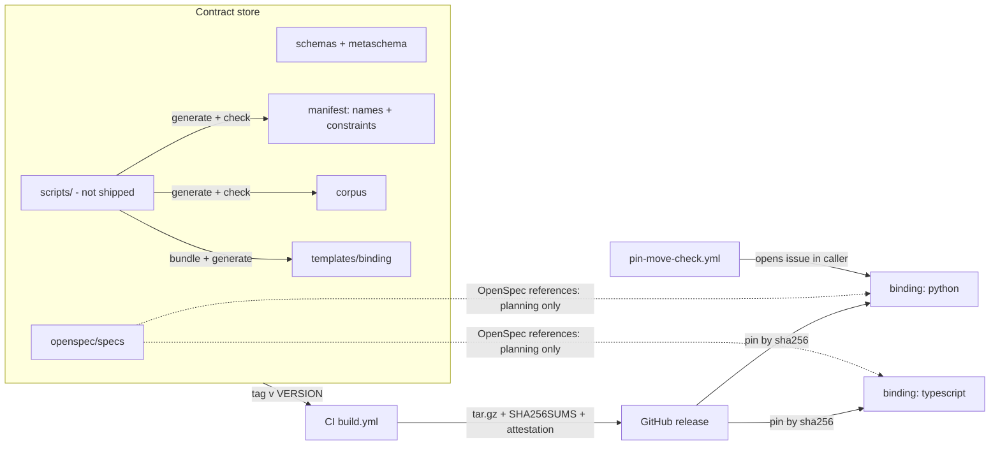
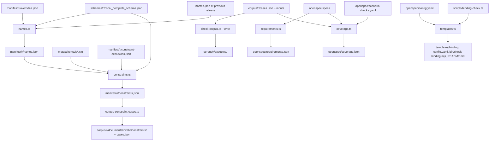

# Architecture

## The model: one contract, many bindings

The contract store publishes a versioned, hash-pinned archive (the spec artifact). Each language binding lives in its
own repository, pins one archive, implements the specs, and passes the corpus. Nothing in the store depends on a
binding ([STO-003]).

## Two ways a binding reads the store

1. **Planning context.** A `references` entry in the binding's `openspec/config.yaml`. It pins no version and is never
   used for a build or check.
2. **Builds and checks.** The release archive, pinned by its `sha256` ([VER-005]). Only the paths in `CONTENTS` of
   `scripts/build-archive.ts` are in the archive: `LICENSE`, `VERSION`, `corpus`, `docs`, `manifest`, `metaschema`,
   `openspec/requirements.json`, `openspec/spec-ids.yaml`, `openspec/specs`, `openspec/traceability.schema.json`,
   `schemas`, `templates`.

## The boundary

The store must not hold binding state: known defects, expected failures, conformance results, supported versions,
binding status, or links to individual binding issues or pull requests. `scripts/check-binding-links.ts` enforces the
link rule on tracked files outside `openspec/changes/`. Each binding keeps its own expected failures ([VER-007]) and its
own traceability record ([SRF-003]).

The binding side of this boundary is `templates/binding/AGENTS.md`, which `install.sh` copies into each binding.

## Generation pipeline

Most contract files are generated from vendored NIST inputs plus a small hand-edited input. A check regenerates in
memory and fails on any difference.

## Independent reference implementations

The store proves its own artifacts without a binding by using two independent paths and comparing them:

1. **Constraints.** `metapath.ts` and `constraint-reference.ts` evaluate Metaschema constraints directly from the
   Metapath (no RFC 9535 library). `constraints-manifest.ts` evaluates the generated `constraints.json` with RFC 9535
   queries only (through `jsonpath.ts`, json-p3 in strict mode). `constraints-check.ts` requires both to agree on
   generated documents and corpus documents.
2. **Fault injection.** `coverage-faults.ts` patches `constraints-manifest.ts` and requires at least one corpus case
   to detect each fault.
3. **Schema validation.** The corpus checker uses ajv on the vendored schema, with the datatype formats of
   `datatype-rules.ts` in place of a format library.
4. **YAML.** `yaml-reader.ts` is a reference reader so YAML corpus cases are provable. A binding need not read YAML
   this way.

## Design patterns in the tooling

1. **Generate, then check by regeneration.** Each generated file has a `:write` and a check mode that compares with
   the committed file.
2. **Self-tests named by scenario.** A self-test string that starts with a scenario identifier (for example
   `"STO-006.02: ..."`) counts as the check of that scenario in `openspec/coverage.json`.
3. **Rule-named failures.** Checkers prefix each failure with the rule name, such as `[prefix]` or
   `[vanished-scenario]`.
4. **Fail closed on git state.** `check-releases.ts` fails in a shallow clone, without tags, or without `origin/main`.
5. **One source for lists.** `check-parallel.ts` reads the steps from the `check` script. `verify-release.sh` reads
   `CONTENTS` from `build-archive.ts` as text at each tag. `check-binding-links.ts` reads the README list of bindings.
6. **Shared checker code.** `binding-check.ts` imports `checkSpecIds()` and `checkRecord()` so a binding runs the same
   identifier rules as the store, bundled into one `.mjs` with no install.

## Release and supply chain

1. A tag `v<VERSION>` on `main` triggers `build.yml`: tag-on-main and tag-equals-`VERSION` checks, `check:parallel`,
   `npm run archive -- <tag>`, then a separate job signs SLSA provenance and creates a draft release. No npm code runs
   in the job that can mint the OIDC token.
2. A person publishes the draft. Releases are immutable.
3. `verify-release.yml` runs `scripts/verify-release.sh` on publish, weekly, and by hand. It rebuilds each archive with
   `git archive` and runs no code from the tag.
4. All actions are pinned by commit SHA. mise and npm installs are locked.

[STO-003]: ../../openspec/specs/contract-store/spec.md#requirement-sto-003-dependencies-run-from-bindings-to-the-contract-store-never-back
[VER-005]: ../../openspec/specs/schema-versioning/spec.md#requirement-ver-005-spec-artifacts-are-distributed-pinned-and-hash-verified
[VER-007]: ../../openspec/specs/schema-versioning/spec.md#requirement-ver-007-each-binding-keeps-its-own-expected-conformance-failures
[SRF-003]: ../../openspec/specs/binding-surface/spec.md#requirement-srf-003-a-binding-records-the-requirement-that-covers-each-public-operation
