# Codebase information

## Identity

1. Name: `oscal-bindings-specs`. Remote: `https://github.com/cairn-proofs/oscal-bindings-specs`.
   `.openspec-store/store.yaml` registers the store id `oscal-bindings-specs`.
2. Kind: an [OpenSpec store](https://github.com/Fission-AI/OpenSpec/blob/main/docs/stores-beta/user-guide.md), called
   the "contract store" in the specs and docs. It holds the language-neutral contract for OSCAL data bindings. It holds
   no runtime code and no binding.
3. License: Apache-2.0. `package.json` is `private` and the package is never published.
4. Version: `VERSION` holds the spec artifact version, `MAJOR.MINOR.PATCH+oscal.<release>` (for example
   `0.10.0+oscal.1.2.3`). The OSCAL release is Semantic Versioning build metadata.
5. One OSCAL release is vendored: `1.2.3`. Every per-release directory (`schemas/`, `metaschema/`, `manifest/`,
   `corpus/`) is keyed by that release, and most scripts loop over releases.

## Languages and content types

| Content | Where | Role |
|---|---|---|
| Markdown (OpenSpec specs) | `openspec/specs/*/spec.md` | The normative contract: requirements and scenarios with identifiers |
| Markdown (changes) | `openspec/changes/`, `openspec/changes/archive/` | Proposals, designs, delta specs, tasks. Archived changes are history and hold the `design.md` that scripts cite |
| JSON / JSON Schema | `schemas/`, `manifest/`, `corpus/`, `openspec/*.json` | Vendored NIST schemas, manifests, corpus, generated indexes, record schema |
| XML / XSD | `metaschema/<release>/` | Vendored NIST Metaschema modules (resolved) and the Metaschema datatypes XSD |
| YAML | `openspec/config.yaml`, `openspec/spec-ids.yaml`, `openspec/scenario-checks.yaml`, corpus YAML inputs | Authoring rules, identifier ledger, scenario exemptions, YAML corpus inputs |
| TypeScript (Node, ESM) | `scripts/*.ts` | Contract store tooling. Run with `tsx`. Type checked only (`noEmit`) |
| JavaScript (generated) | `templates/binding/bin/check-binding.mjs` | esbuild bundle of `scripts/binding-check.ts`, shipped to bindings |
| POSIX sh / Bash | `templates/binding/hooks/pre-commit`, `templates/binding/bin/install.sh`, `scripts/verify-release.sh` | Binding hook and installer; release verification |
| GitHub Actions YAML | `.github/workflows/` | CI, release verification, reusable pin-move workflow for bindings |

Every content type was read directly. No content type was out of scope.

## Directory map

```mermaid
graph TD
    root[oscal-bindings-specs] --> openspec[openspec/]
    root --> schemas["schemas/&lt;release&gt;/ (NIST, byte-for-byte)"]
    root --> metaschema["metaschema/&lt;release&gt;/ (NIST, byte-for-byte)"]
    root --> manifest[manifest/]
    root --> corpus["corpus/&lt;release&gt;/"]
    root --> docs[docs/]
    root --> templates[templates/binding/]
    root --> scripts[scripts/]
    root --> gh[.github/]

    openspec --> specs[specs/ - 12 capability specs]
    openspec --> changes[changes/ - active + archive/]
    openspec --> ocfg[config.yaml - authoring rules]
    openspec --> ledger[spec-ids.yaml - identifier ledger]
    openspec --> gen1[requirements.json, coverage.json - generated]
    openspec --> sc[scenario-checks.yaml - by-design / gap]
    openspec --> trace[traceability.schema.json]

    manifest --> mrel["&lt;release&gt;/ names.json*, constraints.json*, overrides.json, constraint-exclusions.json"]
    manifest --> mschema[*.schema.json for each manifest file]

    corpus --> cases[cases.json, required-keys.json]
    corpus --> cdocs[documents/valid, documents/invalid, documents/invalid/constraints]
    corpus --> celems[elements/]
    corpus --> cexp[expected/ - generated]

    templates --> tgen["bin/check-binding.mjs*, openspec/config.yaml*, README.md*"]
    templates --> thand[AGENTS.md, hooks/pre-commit, bin/install.sh, openspec/spec-ids.yaml, openspec/traceability.json]

    gh --> build[workflows/build.yml]
    gh --> verify[workflows/verify-release.yml]
    gh --> pin[workflows/pin-move-check.yml]
```

`*` marks a generated file. Untracked or ignored directories: `dist/` (archive output), `tmp/` (scratch),
`node_modules/`, and agent configuration (`.agents/`, `.claude/`, `.kiro/`, `.mcp.json`).

## Capabilities and identifier prefixes

From `openspec/spec-ids.yaml`. A prefix entry is permanent.

| Prefix | Capability | Subject |
|---|---|---|
| BMB | backmatter-builders | Builders for back-matter `hash`, `rlink`, `resource` |
| SRF | binding-surface | Allowed public operations, binding-local operations, the traceability record, the sticker |
| CNS | constraint-validation | Metaschema constraints the JSON Schema cannot state, and how a binding evaluates them |
| STO | contract-store | What the store builds, publishes and checks: artifact, version, vendored files, manifests, corpus, templates |
| FAC | document-facade | Uniform accessor over the eight document types |
| PRS | document-parsing | Parse from text, bytes, or file. Typed parsers. Datatype formats. Limits |
| ELV | element-validation | Validate a standalone element against a named type |
| ERR | error-model | Error category taxonomy |
| GEN | generated-models | What a binding does when it generates types from the naming manifest |
| VER | schema-versioning | Namespace scope, pinning, the binding/store boundary |
| SER | serialization | Write a typed document to OSCAL JSON |
| YML | yaml-documents | Optional YAML read and write |
| MDL | model-derivation | No spec directory. The requirements moved to `contract-store` (see `retired`) |
| NAM | naming-manifest | No spec directory. The requirements moved to `contract-store` (see `retired`) |

`STO` requirements are the ones the store itself runs or publishes. The other prefixes state binding behavior, which
the corpus and the manifests make testable.

## Technology stack

1. Runtime: Node, pinned in `mise.toml` and `package.json` `engines`. `.npmrc` sets `engine-strict`, `save-exact`, and
   `ignore-scripts`.
2. OpenSpec CLI: `npm:@fission-ai/openspec`, pinned in `mise.toml` and locked with checksums in `mise.lock` and
   `.mise/`.
3. TypeScript with `tsx`. `tsconfig.json` includes `scripts/**/*.ts` only.
4. npm packages: see [dependencies.md](dependencies.md).
