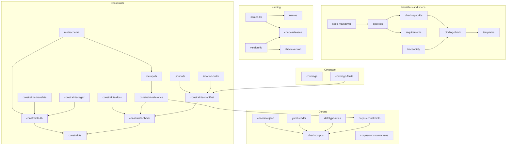

# Components

## Contract content

| Component | Path | Edit by hand? | Generator |
|---|---|---|---|
| Main specs | `openspec/specs/<capability>/spec.md` | Through OpenSpec changes only | |
| Changes | `openspec/changes/`, `archive/` | Yes, while active | |
| Authoring rules | `openspec/config.yaml` | Yes, then `templates:write` | |
| Identifier ledger | `openspec/spec-ids.yaml` | Yes, in the sync or archive commit | |
| Requirement index | `openspec/requirements.json` | No | `requirements:write` |
| Scenario coverage | `openspec/coverage.json` | No | `coverage:write` |
| Scenario exemptions | `openspec/scenario-checks.yaml` | Yes. `gap` may only shrink | |
| Traceability schema | `openspec/traceability.schema.json` | Yes | |
| Vendored JSON Schema | `schemas/<release>/` | Never | |
| Vendored Metaschema | `metaschema/<release>/` | Never | |
| Naming overrides | `manifest/<release>/overrides.json` | Yes | |
| Naming manifest | `manifest/<release>/names.json` | No | `names:write` |
| Constraint exclusions | `manifest/<release>/constraint-exclusions.json` | Yes | |
| Constraint manifest | `manifest/<release>/constraints.json` | No | `constraints:write` |
| Manifest schemas | `manifest/*.schema.json` | Yes | |
| Corpus index | `corpus/<release>/cases.json` | Yes (constraint cases are appended by `corpus:cases`) | |
| Required key pairs | `corpus/<release>/required-keys.json` | Yes | |
| Corpus inputs | `corpus/<release>/documents/`, `elements/` | Yes (`documents/invalid/constraints/` by `corpus:cases`) | |
| Corpus expected | `corpus/<release>/expected/` | No | `corpus:write` |
| Rule docs | `docs/canonical-json.md`, `docs/back-matter-keys.md`, `docs/sticker.md` | Yes | |
| Binding templates (generated) | `templates/binding/bin/check-binding.mjs`, `openspec/config.yaml`, `README.md` | No | `templates:write` |
| Binding templates (hand) | `templates/binding/AGENTS.md`, `hooks/pre-commit`, `bin/install.sh`, `openspec/spec-ids.yaml`, `openspec/traceability.json` | Yes | |

## Scripts by subsystem

The graph shows the main imports, not every one.

| Script | npm scripts | Purpose |
|---|---|---|
| `check-spec-ids.ts` | `spec-ids`, `spec-ids:self-test` | Identifier and ledger rules, no vanished scenarios against `SPEC_IDS_BASE`, cite-only-above rule |
| `spec-ids.ts` | library | Parses headings and the ledger. `WID-002` and `WID-2` are one identifier |
| `spec-markdown.ts` | library | Reads spec Markdown outside fenced code. Computes github-slugger anchors |
| `requirements.ts` | `requirements:write`, `requirements:check`, `requirements:self-test` | Generates `openspec/requirements.json`. Self-test also checks the traceability schema on samples |
| `traceability.ts` | `traceability:self-test` | Checks a binding's traceability record against its pinned store (STO-057) |
| `binding-check.ts` | bundled by `templates:write` | The binding checker: specs, ledger and record of a binding against `--contract-store <dir>` |
| `templates.ts` | `templates:write`, `templates:check`, `templates:self-test` | Generates the binding config (store config + `EDITS`, `ADDED_RULES`, `REFERENCE`), the bundle and the template README. Checks citations in the template `AGENTS.md` |
| `version-lib.ts` | library | `VERSION` grammar and SemVer precedence |
| `check-version.ts` | `version:check`, `version:self-test` | `VERSION` grammar, and the OSCAL release names a `schemas/` directory |
| `check-releases.ts` | `releases:check`, `releases:self-test` | Version step rule, released-name stability, released schema and metaschema immutability, name diff for the CI summary |
| `names-lib.ts` | library | JSON pointers, name derivation, manifest writer and validator |
| `names.ts` | `names:write`, `names:check`, `names:self-test` | Generates and checks each `names.json`, release by release |
| `metaschema.ts` | library | Loads resolved Metaschema XML into definitions, flags, children, constraints |
| `metapath.ts` | library | Reference Metapath parser, data model and evaluator (subset used by OSCAL) |
| `constraint-reference.ts` | `reference:self-test` | Reference evaluation of each constraint kind on Metapath-selected nodes |
| `constraints-translate.ts` | library | Translates Metapath into RFC 9535 queries over OSCAL JSON keys |
| `constraints-regex.ts` | library | Writes `matches` regexes and datatype patterns as RFC 9485 I-Regexp |
| `constraints-lib.ts` | library | Builds the constraint manifest from metaschema, names, schema and exclusions |
| `constraints-manifest.ts` | library | Evaluates a constraint manifest with RFC 9535 only (the binding view) |
| `constraints-docs.ts` | library | Generates schema-valid documents that cover every definition, plus corpus documents |
| `constraints-check.ts` | library | Compares query selections and failure counts between the two evaluators |
| `constraints.ts` | `constraints:write`, `constraints:check`, `constraints:self-test` | Generates and checks each `constraints.json`. The slowest step of `check` |
| `jsonpath.ts` | library | json-p3 in strict RFC 9535 mode |
| `location-order.ts` | library | Order of failure locations (Normalized Paths), CNS-026 |
| `check-constraint-exclusions.ts` | `exclusions:check`, `exclusions:self-test` | Each exclusion names exactly one metaschema constraint |
| `check-metaschema-digests.ts` | `metaschema:self-test` | Proves `metaschema:verify` fails on a changed file |
| `datatype-rules.ts` | `datatype-rules:self-test` | Reference `uri`, `uri-reference`, `email`, `date-time` formats for ajv |
| `evaluate-content.ts` | `content:evaluate -- <clone>`, `content:self-test` | Runs both evaluators on a clone of `usnistgov/oscal-content`. Not in `check` except the self-test |
| `canonical-json.ts` | library | Canonical form: no duplicate keys, datetime normalization, RFC 8785 JCS |
| `check-canonical-json.ts` | `canonical:self-test` | Self-test of the canonical form |
| `yaml-reader.ts` | `yaml-reader:self-test` | Reference reader for YAML corpus inputs |
| `check-corpus.ts` | `corpus:check`, `corpus:write`, `corpus:self-test` | Proves every corpus case without a binding. Writes `expected/` |
| `corpus-constraints.ts` | library | Expected constraint failures of a corpus input |
| `corpus-constraint-cases.ts` | `corpus:cases`, `corpus:cases:self-test` | Generates one `parse` case per reportable constraint entry |
| `coverage.ts` | `coverage:write`, `coverage:check`, `coverage:self-test` | Generates `openspec/coverage.json` and enforces scenario coverage rules |
| `coverage-faults.ts` | `coverage:faults`, `coverage:faults:self-test` | Fault injection into the manifest evaluator. An undetected fault fails |
| `check-binding-links.ts` | `binding-links:check`, `binding-links:self-test` | No links to individual binding issues or PRs (STO-003) |
| `build-archive.ts` | `archive`, `archive:self-test` | Builds `dist/oscal-bindings-specs-<version>.tar.gz` and `dist/SHA256SUMS` |
| `check-parallel.ts` | `check:parallel`, `check:parallel:self-test` | Runs the `check` steps in a worker pool. CI uses it |
| `verify-release.sh` | none | Verifies each published release against its tag |

## CI and repository config

| File | Purpose |
|---|---|
| `.github/workflows/build.yml` | `check:parallel` on PRs to `main`, pushes to `main`, `v*` tags, and by hand. A tag also builds, attests and drafts a release |
| `.github/workflows/verify-release.yml` | Runs `verify-release.sh` on publish, weekly, and by hand |
| `.github/workflows/pin-move-check.yml` | Reusable workflow a binding calls on a schedule. Opens "Move the spec pin to v<version>" in the binding's tracker |
| `.github/CODEOWNERS` | Code-owner review for nearly every tracked path |
| `.github/pull_request_template.md` | Summary, naming manifest section, tests |
| `.gitattributes` | Marks `names.json` and `requirements.json` as generated |
| `mise.toml`, `mise.lock`, `.mise/` | Node and OpenSpec CLI pins with checksums |
| `.npmrc` | `save-exact`, `ignore-scripts`, `engine-strict` |
