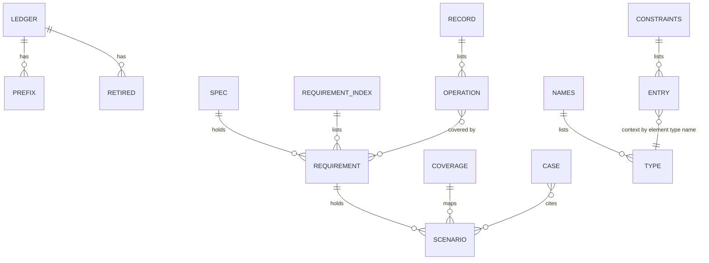

# Data models

Each JSON model has a JSON Schema in the repo. The schema is the reference. This file gives the shape.

## Identifiers

1. Requirement: `<PREFIX>-<NNN>`, heading `### Requirement: <PREFIX>-<NNN> <title>`. Scenario: `<PREFIX>-<NNN>.<NN>`.
   Leading zeros do not make a different identifier.
2. Requirements sit in reading order, not identifier order.
3. A spec can cite only requirements above it in reading order (cite-only-above rule). Full rules:
   `openspec/config.yaml`.

## `openspec/spec-ids.yaml` (ledger)

1. `prefixes`: `PREFIX -> { capability, next }`. `next` is the next free requirement number. Entries are permanent.
2. `retired`: `{ id, reason, replaced_by? }`. A retired identifier is never reused.

## `openspec/requirements.json` (generated)

A list of `{ id, capability, title }` for each requirement of the main specs.

## `openspec/coverage.json` (generated)

`{ format: 1, scenarios: [ { id, capability, corpus?: [caseId], self-test?: [{ script, test }], by-design?: reason,
gap?: issue } ] }`.

## `openspec/scenario-checks.yaml`

1. `by-design: { <scenarioId>: <reason> }`: no store script can check the scenario.
2. `gap: { <scenarioId>: <issue number> }`: a check is possible but missing. The list may only shrink. It is empty.

## `openspec/traceability.schema.json` (binding record)

Format 1: `{ format: 1, operations: [entry] }`. An entry is either `{ name, requirements: [contract id, ...] }` or
`{ name, binding-local: <binding requirement id> }`. The template record is `{ "format": 1, "operations": [] }`. The active change `one-badge-in-the-record`
proposes format 2 (pin, per-requirement status, badge text, corpus result).

## `manifest/<release>/names.json` (generated)

`{ format, oscal-release, schema, types: [ { name, kind, sites: [JSON pointer into the complete schema] } ] }`. Type
identity is the set of pointers. A released name is stable unless `VERSION` takes a breaking step.

## `manifest/<release>/overrides.json`

The only hand-edited naming input. Pins or renames canonical names.

## `manifest/<release>/constraints.json` (generated)

`{ entries, format, oscal-release }`. Each entry has `id` (may be absent), `kind`, `module`, `definition`
(`kind:name`), `level`, `reportable`, `context` (`document` queries and `elements` queries keyed by element type name),
and kind-specific members such as `allow-other`. Kinds: `allowed-values`, `matches`, `has-cardinality`, `is-unique`,
`index`, `index-has-key`, `expect`. A relative query runs on a one-element array that wraps its node, so `$[0]` is the
node.

## `manifest/<release>/constraint-exclusions.json`

`{ format, oscal-release, excluded, cannot-fail }`. Each item names one metaschema constraint by `id`, or by module,
definition and kind when it has no `id`.

## `corpus/<release>/cases.json`

`{ oscal-release, categories, cases }`. A case has `id`, `operation`, `input`, and operation-specific members such as
`document-type`, `expected`, expected error category, expected constraint failures with locations, `requirements`
(scenario identifiers it proves), and `source` (repository, commit, path, `sha256`) for inputs copied from NIST.

Operations: `round-trip`, `parse`, `parse-typed`, `parse-file`, `assessment-period`, `facade`, `validate-element`,
`element-types`, `build-resource`, `build-hash`, `build-rlink`, `yaml-round-trip`, `yaml-parse`, `yaml-parse-typed`,
`yaml-parse-file`. `corpus/<release>/README.md` defines each.

## `corpus/<release>/required-keys.json`

`{ pairs: ["parent>child", ...] }`: key pairs that the valid corpus must use (STO-005).

## `VERSION`

One line, `MAJOR.MINOR.PATCH+oscal.<release>`, no pre-release label. It must equal the latest release or be one step
above it.
