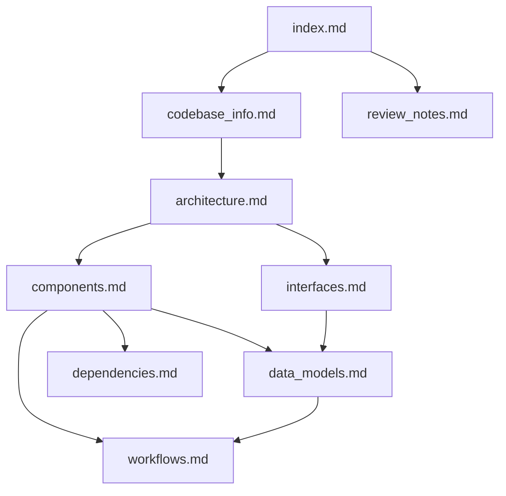

# Knowledge base index: oscal-bindings-specs

## How to use this knowledge base

1. Read this file first. It is enough to choose which other file answers a question.
2. Open only the file that the routing table names. Each file is short and self-contained.
3. For normative rules, read the spec in `openspec/specs/<capability>/spec.md`. These summaries describe the repo. They
   do not replace the specs.
4. For authoring rules of OpenSpec artifacts, read `openspec/config.yaml`. These summaries do not copy it.
5. When a summary and a repo file disagree, the repo file is correct. Record the difference in `review_notes.md`.

## Repository in one paragraph

An OpenSpec store, called the contract store, that holds the language-neutral contract for OSCAL data bindings:
capability specs, the vendored NIST OSCAL JSON Schema and Metaschema, a generated naming manifest and constraint
manifest, a conformance corpus, and binding templates (installer, pre-commit hook, bundled binding checker, agent
guide). It holds no runtime code and no binding state. Bindings in other repositories pin a tagged release archive by
`sha256`. TypeScript scripts in `scripts/`, run by `npm run check`, generate the derived files and enforce identifier,
coverage, corpus, constraint, link, template and release rules. Two independent constraint evaluators (Metapath and
RFC 9535) check each other.

## Files

| File | Content | Consult for |
|---|---|---|
| [codebase_info.md](codebase_info.md) | Identity, content types, directory map, capability prefixes, stack | "Where is X?", "Which prefix is capability Y?" |
| [architecture.md](architecture.md) | Store-to-binding model, boundary, generation pipeline, reference evaluators, tooling patterns, release chain | "Can the store hold Z?", "How is file X produced?", "Why two evaluators?" |
| [components.md](components.md) | Each contract file (generated or hand-edited), each script and its npm scripts, CI config | "Which script checks X?", "Can I edit this file?" |
| [interfaces.md](interfaces.md) | Archive files bindings read, install script, hook, checker, pin-move workflow, gotchas | "What ships in a release?", "How does a binding run the checker?", "Why does a check fail locally?" |
| [data_models.md](data_models.md) | Identifiers, ledger, requirement index, coverage, record, names, constraints, exclusions, corpus, `VERSION` | "What fields does X have?" |
| [workflows.md](workflows.md) | Change a requirement, name, constraint or corpus case; binding operations; release; verification | "How do I change X?", "Which files do I regenerate?" |
| [dependencies.md](dependencies.md) | Toolchain, npm packages and their users, external NIST data, pinned actions | "Why is this dependency here?", "How is it pinned?" |
| [review_notes.md](review_notes.md) | Inconsistencies, gaps, recommendations | Known doc and tooling defects |

## Relationships

## Primary sources in the repo

1. `AGENTS.md`: the short entry point for agents, at the repo root.
2. `README.md`: layout, store use, known implementations, check list, version rules, release, release verification.
3. `CONTRIBUTING.md`: requirement changes, coverage, binding operations, promotion of binding-local operations.
4. `openspec/config.yaml`: authoring rules for OpenSpec artifacts.
5. `corpus/<release>/README.md`: corpus layout, case fields, operations, input forms, how the corpus is checked.
6. `manifest/<release>/README.md`: manifest files and how to change a name.
7. `templates/binding/README.md` and `templates/binding/AGENTS.md`: binding install and the binding side of the
   boundary.
8. The header comment of each script in `scripts/`.
9. `design.md` of archived changes in `openspec/changes/archive/`: scripts cite their decisions (`D1`, `D2`, ...).
