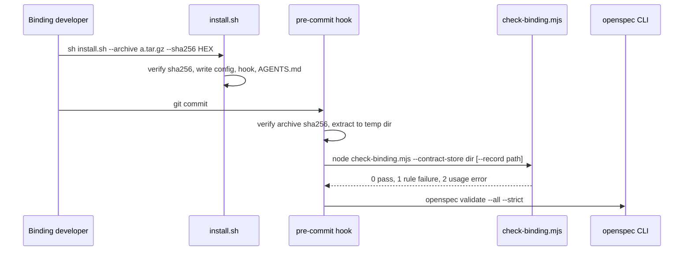

# Interfaces

The store has no runtime API. Its interfaces are files that bindings read, tools that bindings run, and workflows that
bindings call.

## Files a binding reads (in the archive)

| File | Consumer use |
|---|---|
| `openspec/specs/*/spec.md` | The requirements a binding implements and cites |
| `openspec/requirements.json` | Resolves contract identifiers in the binding's traceability record (SRF-004) |
| `openspec/spec-ids.yaml` | Lets the binding checker reject a binding-local prefix that collides with a store prefix (SRF-010) |
| `openspec/traceability.schema.json` | The format of the binding's record |
| `manifest/<release>/names.json` | Canonical type names, kinds and schema pointers for generated models |
| `manifest/<release>/constraints.json` | Constraints as RFC 9535 queries that a binding runs |
| `schemas/<release>/*.json` | The validation schema |
| `metaschema/<release>/` | Source of the constraint manifest. A binding does not need to read it |
| `corpus/<release>/` | Cases, inputs and expected outputs for the conformance run |
| `docs/*.md` | Canonical JSON, back-matter keys, and the README sticker |
| `templates/binding/` | Install script, hook, checker, config, empty ledger and record, agent guide |
| `VERSION`, `LICENSE` | Version and license |

A binding can rely only on these paths. Tooling, changes, CI config and generated coverage stay out of the archive.

## Tools a binding runs

1. `install.sh --archive <tar.gz> --sha256 <hex> [--record <path>] [--hooks-dir <dir>]`. Writes
   `openspec/config.yaml` and the hook every time. Writes the ledger and record only when absent. Writes `AGENTS.md`
   and keeps its "Binding notes" section. Sets `core.hooksPath` only when unset.
2. `hooks/pre-commit` reads `OSCAL_SPECS_ARCHIVE`, `OSCAL_SPECS_SHA256`, `OSCAL_SPECS_RECORD`.
3. `check-binding.mjs` needs Node and git only. `SPEC_IDS_BASE` sets the vanished-scenario base (default `HEAD`).

## Reusable workflow

`pin-move-check.yml` (`workflow_call`) takes `pinned-version`. It compares it with the latest published release and
opens one issue in the caller's repository when they differ and no issue with that title exists. It needs
`issues: write` and no secret. The caller pins the workflow by commit SHA.

## Store-internal interfaces

1. `npm run <script>`: see [components.md](components.md). `npm run check` is the serial gate.
   `npm run check:parallel` runs the same steps and is what CI runs.
2. `SPEC_IDS_BASE`: base ref for the vanished-scenario check, the coverage base rule, and the name diff.
3. `scripts/verify-release.sh v<version>`: needs `gh` signed in and a clone with tags.
4. `CONTENTS` in `build-archive.ts`: a literal array of double-quoted strings ending with `];`, parsed as text by
   `verify-release.sh`.

## Gotchas

1. `releases:check` needs full history, tags and `origin/main`. It fails in a shallow clone.
2. `schemas:verify` and `metaschema:verify` hard-code `1.2.3` in `package.json`.
3. `templates:check` fails after a change to `openspec/config.yaml` or to the identifier checks until
   `templates:write` runs (STO-058).
4. `coverage:check` fails when a new scenario has no corpus case, no self-test name, and no `by-design` entry.
