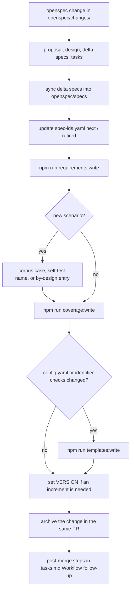
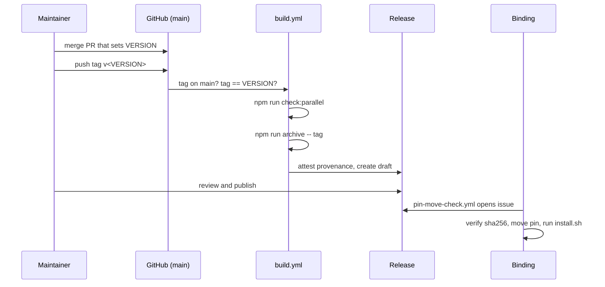

# Workflows

## Change a requirement

1. Read `openspec/config.yaml` first. It requires the `/asd-ste100` skill for artifacts, numbered lists, no historical
   narration in specs, and github-slugger anchors for links.
2. One pull request carries the change from proposal to archive.
3. Binding issues that a change needs, the release tag and pin-move issues go in `## Workflow follow-up` of `tasks.md`.

## Change a canonical name

1. Edit `manifest/<release>/overrides.json`.
2. `npm run names:write`, then `npm run constraints:write` (the constraint manifest keys element contexts by name).
3. A changed released name needs a breaking `VERSION` step. The PR template has a naming section. CI writes the name
   diff to the job summary.

## Change constraints

1. Edit `manifest/<release>/constraint-exclusions.json` when a constraint is excluded or cannot fail.
2. `npm run constraints:write`.
3. `npm run corpus:cases` to regenerate the constraint `parse` cases and inputs, then `npm run corpus:write`.
4. `npm run coverage:write`, and run `npm run coverage:faults`.

## Change the corpus

1. Add the input under `documents/` or `elements/` and a case in `cases.json`. Each file needs a case.
2. Cite the scenario identifiers the case proves in `requirements`.
3. `npm run corpus:write` for expected outputs, then `npm run coverage:write`.

## Binding operations

1. A binding exposes only operations a requirement defines (SRF-001).
2. A binding-local operation must meet SRF-002 and uses a binding prefix, never a store prefix (SRF-010).
3. When two bindings need the same local operation, open an issue in this store to promote it.

## Release

## Verify a release

1. `shasum -a 256 -c SHA256SUMS`.
2. `gh attestation verify` with the `build.yml@refs/tags/v<version>` identity.
3. `gh release verify-asset`.
4. `scripts/verify-release.sh v<version>` in a clone with tags.

Releases up to `v0.7.0+oscal.1.2.3` have no provenance. `v0.1.0` and `v0.2.0` are not immutable.

## Local verification

1. `mise install`, `npm ci`.
2. `npm run check` (serial gate) or `npm run check:parallel` (what CI runs).
3. Set `SPEC_IDS_BASE=origin/main` to match a PR run.
