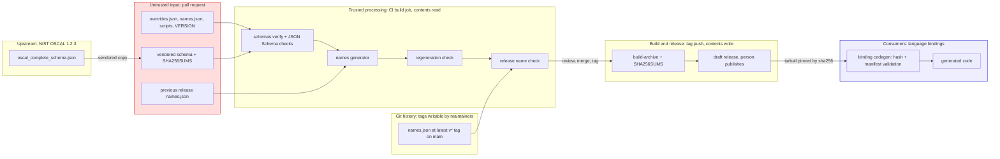

## Context

See [proposal.md, Why](proposal.md#why). These facts about the 1.2.3 inputs shape the approach:

1. The complete schema has 142 definitions. Each of the 126 definitions with `$id` has `$id` equal to
   `#/definitions/<key>`, so for a definition the `$id`, the key, and the JSON pointer are the same identifier. The 16
   `*Datatype` definitions have no `$id` and are scalars.
2. 19 definitions with a namespace are scalars. 8 definitions are unions (`anyOf` with object branches). One
   definition, `assessment-common:risk-status`, is an open enum. The other definitions are objects.
3. The schema has 51 inline object places, 13 unions (8 definitions, 5 inline), 53 enum places (27 open in `anyOf`,
   26 closed in `allOf`), 1 single-or-many property (`mapping-collection/mappings`), 8 document wrappers at
   `#/oneOf/<n>`, and the document union at `#`. 41 list places need a singular local name.
4. Each branch of each of the 13 unions has exactly one property that no other branch has.
5. Trial runs of the rules with `jq` gave 251 places and about 246 types after the merges of [MDL-013]. The trials
   used the plural property keys, because the singular names do not exist yet. They found these items:
   1. Five names that occur twice. Each pair is a copy in the branches of one union, which [MDL-013] merges.
   2. With the parent *local* name, one collision: `StatusState` for the `state` enums of `ssp:status`,
      `system-component/status`, and `finding-target/status`. With the parent *canonical* name ([MDL-010]), no
      collision. 26 names differ between the two rules. All of them are two or more levels below a definition.
   3. Two stutters: `RiskRiskLog` and `SystemInformationInformationTypes`.
   4. The inline `custom` object of the `merge` union has the rule-derived name `MergeCustom`.
   5. The longest name is `SystemInformationInformationTypesCategorizationsSystem`, with 54 characters.
6. The Python binding uses `--reuse-model`, which merges equal inline schemas, and names the rest with ordinals. Its
   naming maps are keys of generated class names, except `COLLISION_OVERRIDES`, which uses definition keys.
7. The store toolchain is TypeScript on Node with `ajv`, `tsx`, and an `npm run check` gate in CI
   (`.github/workflows/build.yml`).

## Goals / Non-Goals

**Goals:**

1. A manifest format that a binding can consume without the Python code and without the naming rules.
2. Names that a reader can predict from OSCAL, and that stay the same when OSCAL adds types.
3. A small hand-edited input, and a check that the committed manifest is the generator output.

**Non-Goals:**

1. Field names, enum values, and enum member names. They come from the schema and each language's casing rules.
2. Scalar types. A binding exposes them as constrained values ([MDL-003]).
3. How a binding represents a union. The manifest names every branch. A binding can use a tagged union, or one type with
   fields that exclude each other. The corpus checks behavior.
4. The parse rule for closed enums. A separate change adds it to `document-parsing` with corpus cases.
5. Reading Metaschema in the generator.

## Decisions

### D1 — Identity is a set of JSON pointers into the complete schema

Each entry holds the pointers of the places that define the type ([NAM-001]).

- **Why:** a pointer identifies every kind of place, including inline objects, enum places, and branches, which have
  no `$id`. For a definition, the pointer is the `$id`. A set of pointers records a merge without a separate map.
- **Alternatives considered:**
  1. *Key by `$id`.* Covers definitions only. 113 Python types have no `$id`. Rejected.
  2. *Key by generated class name.* Ties the contract to one generator. Rejected (see proposal).
  3. *Accept per-document schemas.* Each per-document schema has its own pointers, so one type would have eight
     identities. Rejected. A binding that reads per-document schemas maps them to the complete schema itself.

### D2 — Names follow OSCAL name scopes

OSCAL scopes a definition name to its module and an inline name to its parent. The rules follow those scopes:

```
definition            -> local name                      Parameter
same local, 2 modules -> module + local (all in clash)   SspControlImplementation
inline type           -> parent name + local             SystemComponentStatus, TaskTimingOnDate
list item             -> parent name + singular local    PoamItemOrigin, BackMatterResource
enum                  -> owner name + property local     HashAlgorithm, FindingTargetStatusState
union branch          -> union name + With + property    CatalogGroupWithGroups
single-or-many        -> owner name + property key       MappingCollectionMappings
document wrapper      -> body field + Document           SystemSecurityPlanDocument
document union        -> OscalDocument
```

"Parent name" and "owner name" are the canonical name of the nearest enclosing definition, inline type, or union. A
type in a union branch uses the name of the union, because a branch is a variant of the union and not a name scope.

- **Why the parent *canonical* name:** a canonical name is a path from a definition, so two inline types get the same
  name only through an unlucky concatenation. Siblings share a prefix (`FindingTargetStatusState` and
  `FindingTargetStatusReason`), and a type in a branch shares the prefix of its branch (`TaskTimingOnDate` and
  `TaskTimingWithOnDate`). An override name of a parent carries down to every type below it, so one override fixes a
  stutter at each level.
- **Alternative considered: the parent *local* name.** It gives shorter names for types two or more levels down, for
  example `InformationTypeCategorization`. But a local name such as `status` is unique only inside its own parent.
  The trial run found a collision of three `state` enums (Context, item 5). An override can resolve the collision, but
  the overridden names then differ in form from their siblings: `FindingTargetStatusState` next to `StatusReason`.
  Rejected, because consistent names are worth more than short names.
- **Why always qualify inline types:** a rule that qualifies only on a clash renames an existing type when OSCAL adds
  a type with the same local name. That rename is a breaking change for each binding. Longer names cost less.
- **Why definitions keep the bare local name:** a module prefix on every definition gives `CatalogCatalog` and
  `MetadataMetadata`. Rejected. Pinning (D5) protects definition names from later clashes instead.
- **First manifest and the clash rule:** 1.2.3 has no previous manifest. The five definition clashes (`group`,
  `select-control-by-id`, `control-implementation`, `implemented-requirement`, `statement`) get module prefixes on both
  sides, as the Python binding does. The three Python inline-collision overrides (`SspStatus`,
  `AssessmentCommonOrigin`, `PoamLocalDefinitions`) are not necessary. The inline types carry their parent name, so
  the definitions keep `Status`, `Origin`, and `LocalDefinitions`.
- **Branch names:** the `With` form reads well for content (`ParameterWithSelect`) and less well for modes
  (`MergeWithFlat`). The rule stays uniform. The `merge` branches keep `MergeWithFlat`, `MergeWithAsIs`, and
  `MergeWithCustom`. The shorter `MergeCustom` is not available, because the rule gives that name to the inline
  `custom` object (Context, item 5).
- **Overrides only where the rules fail or stutter:** an override is necessary for a collision and is useful for a
  stutter. The first set is `RiskLog` for `RiskRiskLog`. `InformationType` for `SystemInformationInformationType` is a
  candidate. With it, the longest name drops from 52 characters to `InformationTypeCategorizationSystem`. Task 3.4
  reviews the rest, for example `TaskTimingWithWithinDateRange`.

### D3 — The published manifest is complete, and the hand-edited data is small

`names.json` lists every canonical type. `overrides.json` holds only what the rules cannot produce:

```
 overrides.json (hand-edited)         names.json (generated, published)
 +----------------------------+       +--------------------------------+
 | local-names: ptr -> local  |  gen  | one entry per canonical type   |
 | names:       ptr -> Name   | ----> | name, kind, sites[], kind data |
 | merges:      [ptr, ptr...] |       | bindings read only this file      |
 +----------------------------+       +--------------------------------+
        ^                                    |
        | schema + previous release names    | CI: regenerate == committed
```

- **Why:** a manifest of exceptions only would make each binding run the naming rules. Prose rules drift between
  bindings, which is the reason the manifest exists (phase 1, D2). A complete file also lets a binding skip the
  structural comparison for merges ([MDL-009]).
- **Why a separate hand-edited file:** people review a short file of decisions, not a generated table of about 300
  entries. The regeneration check ([NAM-006]) keeps the two files in step.

### D4 — File formats

Both files use kebab-case keys, as `corpus/<release>/cases.json` does. Entries are sorted by name, and pointers in an
entry are sorted. The generator writes two-space indentation, sorted object keys, and a final newline, so the file is
byte-stable and its diffs are readable. A sketch:

```json
{
  "format": 1,
  "oscal-release": "1.2.3",
  "schema": { "file": "oscal_complete_schema.json", "sha256": "<hex>" },
  "types": [
    { "name": "CatalogGroup", "kind": "union",
      "sites": ["#/definitions/oscal-complete-oscal-catalog:group"],
      "variants": [ { "type": "CatalogGroupWithControls", "property": "controls" },
                    { "type": "CatalogGroupWithGroups", "property": "groups" } ] },
    { "name": "HashAlgorithm", "kind": "enum", "closed": false,
      "sites": ["#/definitions/oscal-complete-oscal-metadata:hash/properties/algorithm/anyOf/1"] },
    { "name": "MappingCollectionMappings", "kind": "single-or-many", "item": "Mapping",
      "sites": ["#/definitions/oscal-complete-oscal-mapping:mapping-collection/properties/mappings"] },
    { "name": "SystemSecurityPlanDocument", "kind": "document", "body-field": "system-security-plan",
      "sites": ["#/oneOf/4"] }
  ]
}
```

```json
{
  "format": 1,
  "oscal-release": "1.2.3",
  "local-names": { "#/definitions/oscal-complete-oscal-poam:poam-item/properties/origins/items": "origin" },
  "names": { "#/definitions/oscal-complete-oscal-assessment-common:risk/properties/risk-log": "RiskLog" },
  "merges": []
}
```

The JSON Schemas are `manifest/names.schema.json` and `manifest/overrides.schema.json`. They hold the format version,
so a later format is a new schema file and a new `format` value. A pointer in the file is the pointer string, written
with the `~0` and `~1` escapes of RFC 6901 where a key needs them.

- **Alternative considered:** one line per entry in canonical JSON (`docs/canonical-json.md`). It is byte-stable, but a
  diff of one long line is hard to review. Rejected for this file. The canonical-JSON rules stay for corpus comparison.

### D5 — Names are pinned by the previous release manifest

The generator reads the manifest of the previous OSCAL release, if the store holds one, and keeps each name whose
pointer still resolves ([NAM-007]). A separate check compares the manifest with the one in the latest released spec
artifact for the same OSCAL release ([NAM-008]).

- **Why:** pinning makes stability a property of the data, not of the rule. A rule change, a new clash, or a
  new type cannot rename a published type. A rename then happens only through an override, and the version check
  makes it a breaking increment.
- **Why two mechanisms:** pinning works across OSCAL releases, where the inputs differ. The release check works inside
  one OSCAL release, where a pull request edits `overrides.json` between two spec releases.
- **Where the release check gets the released manifest:** from git, at the latest `v*` tag on `main` that names the
  same OSCAL release in its build metadata. CI already fetches full history. Before the first release that holds a
  `names.json`, the check has nothing to compare and passes.
- **Alternative considered:** pin from the committed `names.json` of the same release. That makes every hand edit
  pass the regeneration check, because the generator copies the edit. Rejected.

### D6 — The generator lives in the store, in TypeScript

This decision replaces phase 1 D6, which put the generator in the Python post-processor.

- **Why:** phase 1 D6 reused the Python naming code. This change replaces those rules, so nothing in Python is left to
  reuse. The generator needs only the schema, `overrides.json`, and an earlier manifest. Those are store files. The
  store already checks its data in TypeScript (`check-corpus.ts`), and its CI is the place that publishes the artifact.
- **Consequence:** cairn-proofs/oscal-bindings-python#16 changes from "emit `names.json`" to "consume `names.json`".
  That work was phase 3 in the phase 1 migration plan. It moves earlier and becomes the Python adoption step in the
  Migration Plan below.
- **Alternative considered:** keep the generator in Python, as phase 1 D6 says. Python would then hold rules that it
  does not use itself, and the store could not regenerate its own artifact in CI. Rejected.

### D7 — Singular list-item names come from `overrides.json`, not from Metaschema

The JSON Schema keeps the plural `group-as` key (`origins`) and loses the singular local name (`origin`). The `title`
holds the formal name ("Revision History Entry"), which is not an identifier. 41 places need a singular name.

- **Decision:** a person writes each singular name in `overrides.json` and reads the Metaschema source to find it. The
  generator does not read Metaschema.
- **Why:** pinning (D5) makes this a one-time cost for 1.2.3. A later release adds only the singular names of new
  lists. Reading Metaschema in the generator means mapping Metaschema definitions to JSON pointers, which repeats part
  of the Metaschema-to-JSON-Schema conversion. It also adds a second NIST input to pin and an XML parser.
- **Alternatives considered:**
  1. *Vendor Metaschema and read the names from it.* Rejected for the reasons above. Revisit if a release adds many
     lists.
  2. *Singularize the plural with a heuristic.* Bindings would disagree on irregular words. Rejected.

### D8 — Merges: automatic only for branch copies

Two places merge automatically only when their pointers differ in union branch indexes ([MDL-013]). All other merges
are explicit entries in `overrides.json`.

- **Why:** a union expansion copies one OSCAL type into each branch, so those copies are the same type. Equal values
  at unrelated places can be a coincidence. Python's `--reuse-model` merges them, and a later release that adds a value
  to one of them then splits the type, which is a rename. For 1.2.3, the candidates for an explicit merge include the
  `method`, `matching-rationale`, and `status` enums that `mapping` and `mapping-provenance` share, and the
  `matching-rationale` enum of `map`. Task 3.3 checks them against Metaschema.

### D9 — Release order: provisional format, TS spike, archive, Python adoption

```
 store: this change, release 0.2.0+oscal.1.2.3 (format provisional)
        |
 #17 TS codegen spike: types compile from schema + names.json
        |
   fixes? --yes--> update this change, release 0.3.0+oscal.1.2.3
        | no
 archive this change into the main specs (format settled)
        |
 #16 Python adopts the names (one breaking rename)
```

- **Why the spike and not the full binding:** the spike tests the format: that a second language can generate types from
  it. The full corpus tests parsing and serialization, which do not depend on the format.
- **Why Python adopts last:** the Python names reach real users. A format fix after Python adopts would rename Python
  types twice. The store change costs little to revise at 0.x.
- **Release without archive:** the release builds from the main specs plus the manifest files. The release that holds
  the provisional manifest still holds the phase 1 main specs. Task 6.1 syncs the deltas into the main specs before the
  release, so the published prose and the published manifest agree. Archive then only moves the change directory.

## Risks / Trade-offs

1. [The TS spike shows that the format lacks data] → The format stays provisional until the spike (D9). The `format`
   field and per-format JSON Schemas let a later format exist beside this one.
2. [Some rule-derived names read badly] → Task 3.4 reviews every name before release, and the user approves the
   override list. After release, a rename is a breaking increment, so the review happens once, before 0.2.0.
3. [A singular name is wrong] → It is in `overrides.json`, so a fix is one line. After release it is a breaking
   increment. Task 3.2 takes each name from the Metaschema source, not from memory.
4. [Pointers change between OSCAL releases for a type that did not change] → The generator reports each dropped name
   ([NAM-007]). A person then decides between a new name and an override that keeps the old one. This needs real data
   from a later release, so the generator only reports in this change.
5. [The Python binding diverges from the contract until it adopts the names] → This is expected. Python's
   conformance runner checks behavior, not names. Python adopts the names in its own change after the archive (D9).
6. [Long names] → Accepted for stability (D2). Overrides can shorten a name that is hard to read.

## Threats

See [threat-model.tc.json](./threat-model.tc.json). Open it in Threat Composer for the full model.

This change moves strings from store files into the generated code of each binding. The store checks are the first gate.
The validation in each binding is the second gate, and the specs must make the two gates equal.



A pull request controls every store file, including the previous release manifest (red). Maintainers can move tags
(yellow). The CI checks gate the merge, and each binding validates the manifest again before it generates code.

1. [T1: A manifest string puts code into a binding] → [NAM-003] rejects names outside the pattern. Amend [NAM-003]:
   the pattern matches the full string, because in Python and Ruby `$` also matches before a newline. Each name
   reference (`variants[].type`, `item`, document-union members) matches the pattern and names an entry. A consumer
   rejects an unknown `format` and a different `oscal-release`. Amend [NAM-004]: the JSON Schemas also constrain
   pointers, `property`, `body-field`, and `schema.file`, and a consumer writes these strings only as escaped literals.
2. [T2: A pull request changes names in `overrides.json` or `names.json`] → [NAM-006] and [NAM-008]. Task: CODEOWNERS
   review for `manifest/`, `schemas/`, `scripts/`, and `.github/`.
3. [T3: A pull request edits the previous release manifest to steer [NAM-007]] → Amend [NAM-006]: the checks
   regenerate the manifest of each release, in release order. The generator validates the previous manifest before it
   uses it.
4. [T4: The release check uses a wrong baseline or no baseline] → Task: select from `v*` tags on `origin/main` by
   SemVer precedence, and call git with argument arrays. Amend [NAM-008]: the check fails when it cannot read the tags,
   for example in a shallow clone. Task (repository setting): a ruleset blocks update and deletion of `v*` tags.
5. [T5: A key such as `__proto__` or `constructor` resolves to an inherited property] → Task: resolve pointers through
   own properties only, and use `Map` or null-prototype tables. Self-tests cover these keys, `~0`, `~1`, and `%`.
6. [T6: A `$ref` cycle (`group`, `part`) makes the walk or the merge comparison loop] → Task: the walk does not follow
   `$ref`, and the comparison compares `$ref` strings. The CI job sets `timeout-minutes`.
7. [T7: The manifest pairs with a schema other than the one that a binding parses] → [NAM-002.03]. Task: the generator
   hashes the bytes that it parses. A check fails when a released `schemas/<release>/` file changes.
8. [T8: Output that is not byte-stable trains people to commit generator output without review] → Task: sort by code
   unit, not `localeCompare`, and compare in memory in check mode. A self-test compares two runs ([NAM-006.02]).
9. [T9: The new code runs with more CI privilege than it needs] → The baseline stays (`contents: read`, no persisted
   credentials, pinned actions, `ignore-scripts`). Task: the generator runs only in the `build` job and adds no
   dependency.
10. [T10: A breaking increment hides a rename from reviewers] → Task: the release check lists each changed or removed
    name in the job summary, also when the increment permits the change.

The residual ratings assume that each amendment and task above lands.

| custom:residualRisk | Count |
|---|---|
| Critical | 0 |
| High     | 0 |
| Medium   | 2 |
| Low      | 8 |

**Loop-back gate**: satisfied: no Critical/High residual risk.

## Migration Plan

1. Land this change on the feature branch with the generator, both files, both JSON Schemas, and the checks. CI runs
   them in `npm run check`.
2. Sync the deltas into the main specs, update the ledger, set `VERSION` to `0.2.0+oscal.1.2.3`, and release.
3. The TS spike in cairn-proofs/oscal-bindings-python#17 generates types from the release. Fixes come back as an
   update of this change and a new release.
4. Archive this change.
5. Update cairn-proofs/oscal-bindings-python#16 so that Python consumes `names.json`. The user approves the new text.

**Rollback:** before step 4, revert the release commit and keep the placeholder. No consumer depends on the manifest
until the spike. After Python adopts the names, a rollback is a breaking change and needs its own change.

## Open Questions

1. The exact text of the names that task 3.4 replaces with overrides. It depends on the generated list, and the user
   approves it. It does not change the specs or the format.
2. Per-binding handling of names that clash with language keywords or built-ins, for example `Map` in JavaScript. The
   spike decides whether the manifest needs data for this. If it does, that is a format fix under D9, step 3.
